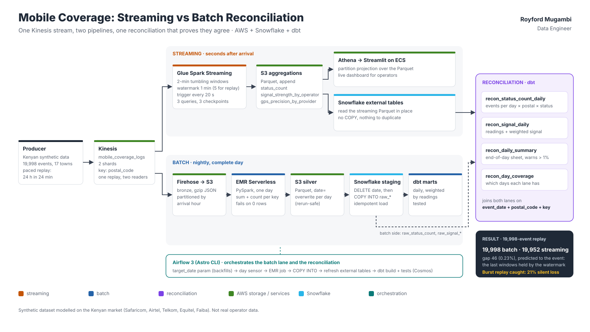

# AWS Streaming vs Batch Reconciliation

Two pipelines process the same mobile-network events, one in real time and one nightly, and a reconciliation layer proves they agree, or says exactly where and why they don't.

On a replay of 19,998 events, reconciliation flagged **46 events, all predicted in advance**: the last windows of the day, held back by the streaming watermark. A week earlier, the same check caught a **21% silent data loss** in the streaming lane ([incident write-up](docs/incidents/2026-11-07/README.md)).

| Replay | Batch | Streaming | Gap | Explained by |
|---|---|---|---|---|
| Burst, 1-min watermark (2026-11-07) | 19,998 | 15,754 | 4,244 (21.2%) | shards read at different speeds; watermark dropped one shard's records as late |
| Paced, 5-min watermark (2026-11-10) | 19,998 | 19,952 | 46 (0.23%) | final windows held by the watermark, predicted to the event |



## How it works

Events are replayed into one Kinesis stream and consumed twice:

| Lane | Path | Output grain |
|---|---|---|
| **Batch** (this repo) | Kinesis → Firehose → S3 bronze (gzip JSON) → EMR Serverless PySpark → S3 silver (Parquet) → Snowflake `COPY INTO` → dbt staging and marts | day × hour × key |
| **Streaming** ([companion repo](https://github.com/Roy-mugambi/realtime-mobile-coverage-pipeline)) | Kinesis → Glue Spark Structured Streaming (2-min windows, watermark) → S3 Parquet → Athena / Snowflake external tables | 2-minute window × key |
| **Reconciliation** (this repo) | dbt models joining both lanes on `event_date × postal_code × status` (event counts) and `× operator` (readings and weighted signal) | day × key |

Airflow (Astro CLI, Airflow 3) orchestrates the batch lane: sensor → EMR → Snowflake load → refresh external tables → dbt build and test, one task per model via Cosmos.

## The data

A synthetic dataset modelled on the Kenyan mobile market: 19,998 readings across 17 towns (Nairobi GPO `00100` to Lodwar `30500`) and five operators (Safaricom, Airtel, Telkom, Equitel, Faiba), with daily usage peaks, evening congestion and weaker rural coverage. It is generated with a fixed seed by `producer/generator.py` in the streaming repo. **It is not real operator data**; the operator mix is an approximate assumption.

Postal codes keep their leading zeros (`00100`, `01000`) on purpose: every layer that might treat them as numbers is tested by them.

## Reconciliation

| Model | Grain | What it answers |
|---|---|---|
| `recon_status_count_daily` | date × postal code × status | Do both lanes count the same events? |
| `recon_signal_daily` | date × postal code × operator | Same readings and the same weighted average signal? |
| `recon_daily_summary` | date | The end-of-day sheet; dbt warns if the gap exceeds 1% |
| `recon_day_coverage` | dataset × date | Which days each lane has; a missing day is a coverage gap, not a mismatch |

Both lanes write `sum` and `count` columns, so any rollup is exact (no averages of averages). Reconciliation compares only days both lanes processed.

## Design decisions

- **Explicit `target_date`.** Airflow 3's cron timetable sets the logical date to the run time, so `{{ ds }}` pointed at today. The DAG takes a `target_date` param (default: yesterday), which also makes backfills one command.
- **Day-level bronze sensor.** Firehose partitions by arrival time and writes no `_SUCCESS` marker; a replay lands in one hour folder, so waiting for `hour=23` could never pass. The sensor waits for any file in the target day; the 02:00 schedule gives Firehose's buffer ample time.
- **Idempotent Snowflake load.** Spark's overwrite writes new file names and `COPY INTO` skips only names it has seen, so a rerun would double-count. The load deletes the target date first; a second run leaves 154 rows / 250 events unchanged.
- **Concatenated Firehose records.** Firehose writes `{...}{...}` with no delimiter; `read.json` kept one record per file (2 of 250). Spark now splits on the object boundary and fails loudly on zero rows; the producer newline-delimits records.
- **Coverage is not a mismatch.** A checkpoint reset once left a whole day missing from streaming. Recon compares only shared days; `recon_day_coverage` reports the rest.
- **Secrets outside the repo.** The Snowflake key lives in `~/.snowflake/` and is mounted read-only into the containers; `dbt/profiles.yml` and `airflow_settings.yaml` are gitignored, with example files committed.

## Repository layout

```
airflow/            Astro project: DAG, Dockerfile, docker-compose.override.yml
spark/              batch_aggregate.py (EMR Serverless)
dbt/                staging, marts and reconciliation models with tests
snowflake/          stages, external tables, grants (all Snowflake objects as code)
iam/                IAM policy templates (EMR, Snowflake integration, Airflow)
tools/              one-off patch scripts
docs/               architecture, incident write-ups, screenshots
```

## Run it

Prerequisites: AWS account (S3, EMR Serverless, IAM), Snowflake account with a storage integration, Astro CLI, Docker, Python 3.11.

```bash
# 1. Snowflake key outside the repo
mkdir -p ~/.snowflake && chmod 700 ~/.snowflake     # put snowflake_rsa_key.p8 here, chmod 644

# 2. Local config from the examples
cp dbt/profiles.example.yml dbt/profiles.yml
cp airflow/airflow_settings.example.yaml airflow/airflow_settings.yaml

# 3. Snowflake objects
#    run snowflake/*.sql as ACCOUNTADMIN

# 4. Airflow (must run from airflow/, where .astro/ lives)
cd airflow && astro dev start

# 5. Process one day (also the backfill command)
astro dev run dags trigger mobile_coverage_daily_batch --conf '{"target_date": "2026-11-10"}'

# dbt locally
export DBT_SNOWFLAKE_PRIVATE_KEY_PATH="$HOME/.snowflake/snowflake_rsa_key.p8"
cd dbt && dbt build --select reconciliation --profiles-dir .
```

## Cost

A full replay and batch run costs well under a dollar: the Glue streaming job and EMR are billed by the minute, and 20,000 events are about 6 MB. The Kinesis stream (about $0.72 a day for 2 shards) is created for a replay and deleted the same day.

## What I'd do next

- Partition streaming output by `event_date` so replays never share folders
- Reconcile GPS precision and satellites (sum/count columns already exist)
- Compact the streaming lane's small files (2,982 files for 20,000 events), or move it to Iceberg
- CI: ruff, pytest, `dbt build` against a dev schema, gitleaks, on every pull request

---
Built by Royford Mugambi. Questions welcome via [LinkedIn](https://www.linkedin.com/in/<your-handle>).
